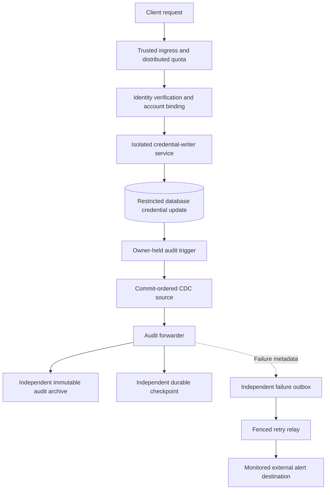

# Credential service and audit pipeline — production integration plan

**Status: PROPOSED / NOT APPROVED / NOT DEPLOYED.** Provider-neutral release
readiness document for [security issue #29](https://github.com/danwiz/project0-cardealership/issues/29).
It is not an instruction to activate infrastructure. All security pull requests
remain **draft and unmerged**; a passing GitHub Actions fixture is not proof of
production controls. No provider, region, retention term, quota, operational
SLO, secret manager or incident destination has been selected.

## Trust boundaries and evidence ownership

The dealership JVM must **not** hold the privileged credential-writer SQL
secret. The audited database, its owner, the credential writer, and the
ordinary application must not be able to rewrite or delete external audit
evidence. Independent administration of the archive, checkpoint and alert
outbox must be verified—not merely assumed because they have separate Java
interfaces. A database owner/superuser remains capable of suppressing events
before extraction; source coverage, owner-threat review and separate
attestation decisions are still required.

## Release gate ledger

Every gate requires a named **implementation owner**, an **independent reviewer**,
an executable or witnessed test, a linked evidence artifact, and a recorded
decision. An empty checkbox, green unit test, proposed API or an assertion from
the implementation owner does not satisfy a production release gate.

| Gate | Required acceptance evidence | Current status |
| --- | --- | --- |
| G01 — Authentication | Real token/session verifier checks signature, issuer, audience, expiry, revocation, account binding and required assurance; rejects forged/missing identities before writer invocation | **Open:** policy seam uses a fake authenticated source, no real verifier |
| G02 — Rate limiting | Distributed pre-verification and per-subject limits remain effective across replicas, restart, forged forwarding headers, burst boundaries and sustained abusive traffic | **Open:** local in-memory fixture only |
| G03 — Writer isolation | Separately deployed service, authenticated private channel, ordinary-app DB role denied credential UPDATE; SQL grant/DDL tests and rollback access check | **Open:** CI-only database roles |
| G04 — Writer secret lifecycle | Workload identity/secret store, rotation, connection-drain, outage/revocation, role separation and no secret disclosure in diagnostics | **Open:** local drain/lease seams only; no real provider or session termination |
| G05 — Database audit integrity | Owner-held trigger catches service and direct-SQL updates, handles rollback, records correct actor/time; non-owner writer cannot disable or alter ledger | **CI fixture passed; production unverified** |
| G06 — CDC completeness | Commit order, same-commit ordinals, metadata fidelity, retention floor, over-acknowledged slot, crash retransmission and failover proven on selected source | **Open:** diagnostic test_decoding only |
| G07 — Immutable archive | Independent administrative ownership, encryption, write-once/retention lock, exact deduplication, read-back, collision rejection and immutable audit access logs | **Open:** in-memory fake receipts only |
| G08 — Checkpoint/fencing | Cross-process durable CAS, source generation binding, lease fencing and replay after abrupt death between append/checkpoint | **Open:** disposable SQL claim, transaction fence and synthetic two-signer receipt verification only; no genuine source/archive attestation or independently reviewed staging lease |
| G09 — Alert persistence and delivery | Durable outbox, bounded leased relay, downstream idempotency, retries/dead letters, destination outage and an independent outbox-health alarm | **Open:** in-memory fake only |
| G10 — Privacy and retention | Approved event schema, minimized identifiers, no credential/header/token/exception disclosure, independent retention/deletion policy and legal review | **Open:** policy/retention undecided |
| G11 — Availability and recovery | Defined backlog/lag, RPO/RTO, capacity, WAL growth thresholds, incident escalation and rehearsed DR runbook | **Open:** SLOs and exercises not set |
| G12 — CI/supply chain | Protected branches, required checks/reviews, pinned/reviewed build dependencies, license/security scan choice and provenance review | **Partial:** Java 11/17 CI; independent review pending |
| G13 — Threat model | Review compromised app, writer, DB owner, archive operator, alert recipient, replay/failover and malicious insider scenarios | **Open:** independent assessment needed |
| G14 — Release authorization | Independent security sign-off, operations ownership, rollback/on-call approval, migration plan and recorded change ticket | **Open:** no production approval |

The [existing CDC source acceptance matrix](credential-cdc-production-acceptance.md),
[durable destination contract](credential-audit-durable-destination.md),
[alert relay contract](credential-audit-alert-outbox-relay.md),
[request gate](trusted-credential-request-gate.md),
[authenticated-session contract](credential-session-verifier-contract.md),
[rotating writer secret source](jdbc-writer-secret-source.md),
[renewable lease policy](renewable-writer-secret-lease.md),
[writer-session drain contract](fenced-writer-connection-drain.md),
[disposable PostgreSQL session-revocation rehearsal](postgresql-writer-session-revocation-rehearsal.md), and
[two-gate commit/fence reconciliation rehearsal](credential-writer-commit-fence-reconciliation.md),
and [reconciled writer activation barrier](reconciled-writer-reopen-barrier.md),
plus [durable SQL rotation claim rehearsal](jdbc-rotation-claim-ledger.md)
and [PostgreSQL transaction-level writer fence](postgresql-writer-epoch-transaction-fence.md),
plus [independently signed receipt verification](signed-rotation-reconciliation-evidence.md)
and [bounded artifact transport adapter](signed-evidence-artifact-transport.md)
and [canonical signed receipt location](canonical-signed-receipt-location.md)
and [version-pinned signed receipt read-back](version-pinned-signed-receipt-readback.md)
and [independently signed receipt pin index](independently-signed-receipt-pin-index.md)
and [JDBC signed receipt pin revision floor](jdbc-signed-receipt-pin-revision-floor.md)
and [authenticated signed-pin publisher](authenticated-signed-pin-publisher.md)
and [immutable signed-pin document publication](immutable-signed-pin-document-publication.md)
and [immutable pin adapter acceptance matrix](immutable-pin-adapter-acceptance-matrix.md)
and [disposable PostgreSQL signed-pin publication rehearsal](postgresql-signed-pin-publication-ci.md)
define the non-deployed code seams and CI-only tests. Their fixture successes
cannot close the release ledger.

## Pre-production acceptance test catalog

Test IDs are stable references for the accompanying
[evidence register](credential-security-release-evidence-register.md). The
implementing team must supply commands, environment identities, timestamps,
logs/traces and independent witness. Never run destructive fault injection on
production, shared databases or the live audit archive.

| Test ID | Staging-only fault or action | Exact pass/stop condition |
| --- | --- | --- |
| AUTH-01 | Expired, wrong-audience, unsigned/forged, revoked and valid credentials; attempt different target username | All invalid claims fail before writer; valid claim affects only bound account; no target supplied by client |
| LIMIT-01 | Burst invalid ingress traffic from trusted gateway context on multiple replicas, restart limiter, forge untrusted proxy header | Pre-verification and post-verification quotas stay enforceable, shared and bounded; no header-controlled bypass |
| WRITER-01 | Use ordinary app SQL role to attempt hash update, role mutation, DDL and audit modification | Every prohibited action denied; restricted writer performs only intended column CAS; no legacy privileged fallback |
| SECRET-01 | Rotate and revoke writer login during active connections, simulate store outage, inspect heap/log policy | Next new connection uses current lease; old secret cannot establish new connection; outage fails closed; no secret in artifacts |
| TRIGGER-01 | Commit service rotation, commit direct-SQL writer rotation, then roll back a rotation | Exactly committed changes audited; rollback absent; restricted writer cannot tamper with trigger or ledger |
| CDC-01 | Overlap transactions so earlier audit ID commits later; commit 2+ rows together; page limit one | Every row emitted in true commit order with stable composite cursor across pages/restart; real timestamp/actor retained |
| CDC-02 | Retain slot name but force WAL retention/pruning, invalidate slot or advance confirmed position beyond unacknowledged checkpoint | Source refuses unknown history with critical error/alert; never returns false EOF or fast-forwards checkpoint |
| CDC-03 | Crash source/consumer, restart, restore snapshot, promote standby or change timeline | Resume complete history idempotently, or fail closed on generation ambiguity; no silent stream ID reuse |
| ARCH-01 | Persist event, replay identical key, attempt same key with changed metadata, request read-back | One immutable accepted event, collision rejected, original untouched and digest/receipt independently verified |
| ARCH-02 | Attempt overwrite/delete/shorten retention using app, writer, DB-owner and archive-reader identities | Immutable evidence and retention lock survive every unauthorized identity and routine operator error |
| CKPT-01 | Two workers race same expected checkpoint, one worker dies immediately after archive acknowledgement | Exactly one durable CAS winner; stale worker fenced; restart deduplicates append without skipping |
| ALERT-01 | Downstream accepts notice then connection drops; relay restarts after lease expiry; stale worker acknowledges | Identical notice retried, downstream dedup/resolution defined, stale token rejected; no lost notice |
| ALERT-02 | Outbox/destination unavailable long enough to exceed operational retry threshold; inject poison notice | Independent health alarm escalates; bounded backoff and dead-letter evidence retained; no silent discard |
| PRIV-01 | Scan service/CDC/archive/outbox payloads, traces and artifacts with synthetic canary secrets | No raw password, encoded credential, bearer token, sensitive header or raw exception in external records |
| DR-01 | Isolated recovery exercise with checkpoint restore, WAL pressure and temporary credential-service outage | Recovery meets **approved** RPO/RTO and preserves immutable evidence; no unsafe bypass or reset |

All rows above are **not yet executed against a production-grade provider**.
Current disposable PostgreSQL and in-memory unit tests support test design,
not these real integration pass declarations.

## Staged deployment and cutover controls

1. **Decision and threat review.** Choose trusted identity/ingress, writer
   workload identity/secret manager, source CDC adapter, WORM archive,
   checkpoint, outbox/alert and independent monitoring. Record data locations,
   permissions, retention, costs and provider exit/recovery options. Require
   independent sign-off; no auto-selection of a paid service.
2. **Isolated rehearsal.** Provision a disposable dedicated environment only
   after approved change scope. Run the catalog, including destructive failure
   injection, without sharing production credentials, database, WAL slots or
   archive namespace. Capture redacted evidence in the register.
3. **Protected staging.** Validate environment-specific RBAC, mTLS/private
   ingress, alert routing/on-call acknowledgement, retention lock, WAL capacity,
   source generation, and access revocation. Independently witness the whole
   append-then-checkpoint pipeline and false-EOF defenses.
4. **Shadow/read-only verification.** Before any production credential writes,
   independently reconcile authorized database mutations with captured audit
   evidence. Shadow mode must not create a second credential-writer path or
   consume live WAL beyond the acknowledged archival position.
5. **Production change approval.** Operations, data owner and independent
   security reviewer approve the exact deploy artifact/configuration, permitted
   network routes, secret lease, rollback instructions, monitoring, explicit
   thresholds, and a change window. Green CI alone never authorizes rollout.
6. **Restricted cutover.** Bring up the isolated trusted service and verify
   user identity, rate limits, archive and alert health before routing changes.
   Revoke the ordinary application role's privileged credential-update ability
   and validate it cannot fall back to legacy direct SQL; if a precondition is
   missing, **do not** accept new rotations.
7. **Observe and reconcile.** Check committed change counts and source coverage
   against archive acknowledgements, checkpoint position, WAL retention budget,
   backlog, alert age, account impact and approved SLOs. Roll forward only after
   independent acceptance evidence.

## Stop, rollback and incident rules

- **Stop/fail closed:** Unknown source generation/history, WAL loss,
  unverified append receipt, stale checkpoint lease, archive collision,
  disabled/undeliverable alerts, identity ambiguity, rate-limit bypass or
  credential writer leakage. Pause new credential rotations; preserve evidence.
- **Rollback:** Restore the last reviewed executable/configuration only if it
  preserves privileged-role separation and audit completeness. Never re-enable
  the normal app's broad credential SQL grants, force-advance a cursor,
  recreate a source generation under the same ID, delete a replication slot,
  unlock a WORM archive or erase a failed outbox to make status green.
- **Recover:** Incident commander and independent security reviewer approve
  source re-bootstrap and any new stream/archive namespace after reconciliation.
  Keep original checkpoint, archived evidence and failure notices for forensics.
- **Privacy:** Evidence packages must use synthetic subject identifiers and
  redacted logs; never capture password, token, private key, connection string
  secret or live customer identifiers in GitHub comments/artifacts.

## Required approvals before 'ready for review' or merge

- [ ] Architecture/owner threat review and accepted provider/deployment choices
- [ ] Independent verification of every applicable gate G01–G14
- [ ] All real integration test IDs recorded with redacted links and reviewers
- [ ] Signed off data retention/privacy, operations runbook, escalation and SLOs
- [ ] Branch protection/review checks satisfied on final integration head
- [ ] Production cutover and fail-closed rollback reviewed and authorized

Until the above evidence exists, keep issue #29 **open** and security PRs
**draft/unmerged**, with no production activation. GitHub's
[protected branch guidance](https://docs.github.com/en/repositories/configuring-branches-and-merges-in-your-repository/managing-protected-branches/about-protected-branches)
explains how independent approvals/status checks can be enforced; no new
branch protection rules or paid security entitlements are changed here.
