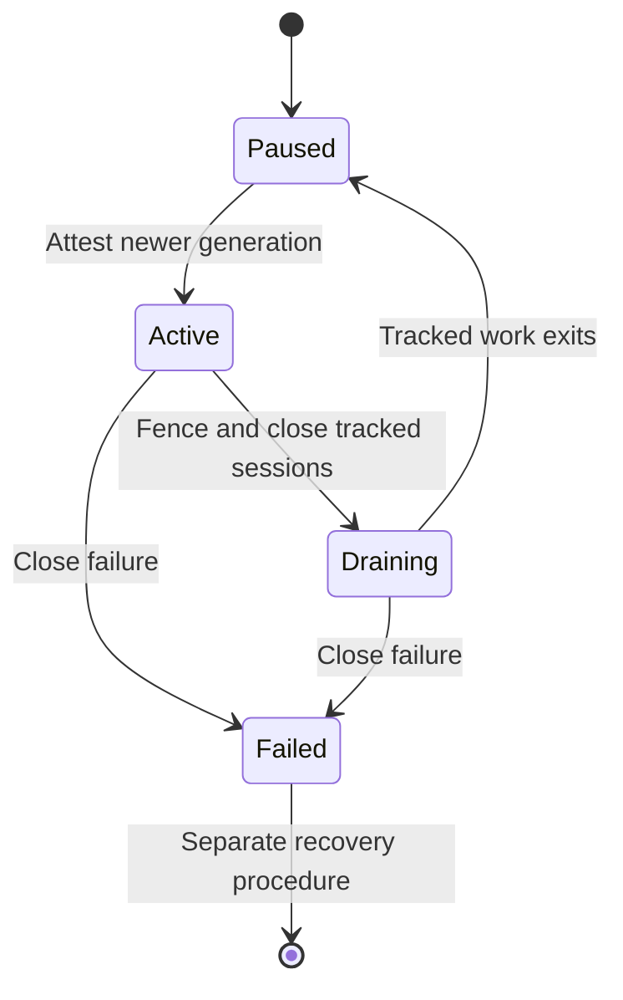

# Writer JDBC connection drain and generation fencing — non-deployed contract

**Status: STAGED / NO LIVE POOL OR SERVER-SIDE REVOCATION.** This contract
does not connect to the running credential service, use a real secret manager,
create or close production JDBC sessions, or change database credentials. It
extends the [renewable writer-secret policy](renewable-writer-secret-lease.md)
with a scoped, in-process **test seam**. Production G03 and G04 / SECRET-01
remain **NOT RUN / NO-GO**.

## Local state machine

`FencedJdbcConnectionGate` starts **paused** and rejects all connections. A
trusted `GenerationAttestor` must verify a strictly newer credential generation
before it activates. `withConnection` then opens a fresh JDBC session through
an injected `ConnectionOpener`, checks that no drain raced it, tracks the
session, executes a synchronous callback and closes it before returning.
The callback must never retain the connection, statement, result set or any
other derived JDBC object after completion.

`pauseAndDrain(expectedGeneration)` invalidates the local fencing token,
refuses new opens and attempts to close every tracked JDBC session. If a
connection was still being established when drain started, its late arrival
is closed and its callback **never runs**. In-flight callbacks whose fence
was invalidated cannot report success after the drain, even if their work
returns normally. Activation is refused until the tracked callbacks have
exited and the close attempts have completed. Close errors permanently
disable this object; failure is not silently converted into availability.

The Java gate checks a **local** generation only. A real attestor must
independently confirm authoritative secret-store lease generation, database
login validity, revocation and durable cross-replica fencing. Do not use a
constant `true` attestor outside these tests. New writer sessions must use
the isolated renewable credential source; the legacy application must not
be allowed to bypass this gate to acquire the privileged SQL role.

## Safety boundaries and operational caveats

- `Connection.close()` is not a proof that a concurrent server-side
  transaction was cancelled, rolled back or even observed the revocation
  before commit. A query may have committed before the gate invalidated its
  return value. Reconcile committed audit events **on the database side**,
  and use a database/operator-approved session termination and transaction
  quiescence protocol for emergency revocation.
- The gate is not a JDBC pool, HTTP server, a cross-process lease holder or
  an automatic secret-rotation orchestrator. It has no background timeout,
  forced interrupt, server PID inventory, persistent generation checkpoint
  or startup recovery; those are required from a selected production adapter.
- Opening happens outside the gate monitor. A drain that races a slow
  connection open will fence and close the late arrival. A blocked callback,
  failed close or leaked JDBC handle leaves the system paused; never bypass
  this condition by re-enabling the legacy broad database writer grant.
- The attestation and pause methods must only be called through a separately
  authenticated, independently reviewed operations control plane. An attacker
  with access to those methods can deny service or assert a bogus generation.
- Actual production rotation must coordinate: stop writer requests, inspect
  active transaction state, drain/terminate old sessions, publish/revoke
  secret generations, validate a **new** DB login, reconcile audit coverage,
  update durable generation/checkpoint evidence and only then authorize a
  gradual reopen. A failure at any step is a **NO-GO**.

## CI coverage and production acceptance

Six disposable-H2 fixture tests exercise initial deny, strictly newer
attestation, local drain/old work fencing, late-open race, provider errors,
close failure and cleanup after callback exceptions. They do not prove
PostgreSQL process termination, cluster-wide fencing, SSL session lifetime,
pool draining, transaction rollback or real provider readiness.

The separate [PostgreSQL 16 CI-only revocation rehearsal](postgresql-writer-session-revocation-rehearsal.md)
checks local drain/transaction rollback, stale password denial, current-login
reopening and test-owned backend termination against real PostgreSQL sessions.
This improves test coverage but is **not independent staging acceptance**.

Before [SECRET-01](credential-security-production-integration-plan.md) can
close, select a real provider and independently witness staging tests with
two live writer replicas and a real PostgreSQL connection pool: pre-rotation
in-flight transactions, slow opens, network partitions, stale generations,
provider outage, forced role revocation and reconciliation of committed
changes. The [evidence register](credential-security-release-evidence-register.md)
must retain redacted logs, generation/connection inventory and reviewer
decision. No fault injection may occur on production or shared databases.

References: [Java JDBC Connection contract](https://docs.oracle.com/en/java/javase/17/docs/api/java.sql/java/sql/Connection.html),
[PostgreSQL server session administration](https://www.postgresql.org/docs/current/functions-admin.html),
[OWASP Secrets Management Cheat Sheet](https://cheatsheetseries.owasp.org/cheatsheets/Secrets_Management_Cheat_Sheet.html).

Keep issue #29 **open**, security PRs **draft/unmerged**, and production
release gates **NO-GO**. No paid GitHub Code Security entitlements, live
secrets, production DB roles, replication slots, services or deployments are
activated.
